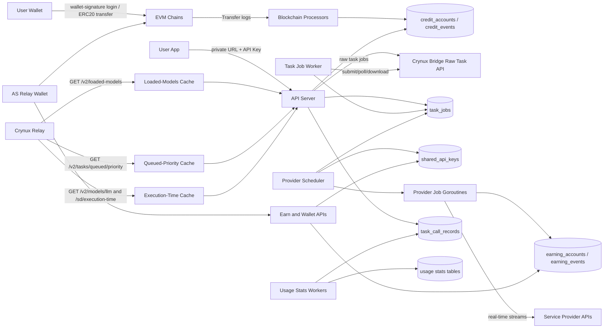

# Technical Architecture

## System Boundary

Crynux AS is one off-chain backend service backed by one MySQL database. It works with multiple configured blockchain networks for receiving ERC20 payments, with one Crynux Bridge instance for Crynux task execution, with one Crynux Relay instance for the loaded Crynux model catalog, and with configured OpenAI, Anthropic, and Google APIs for Provider text-model execution. It stores encrypted user-owned Shared API Keys, records Key Owner CNX earnings, and exposes settlement APIs to one unmodified Relay Wallet deployment. The term `network` in this document means blockchain network.

## Components

* **API server** (`api/`): management APIs under `/v1`, project OpenAI-compatible and Raw Task APIs under `/api/<endpoint_token>/v1`, Remote MCP under `/api/<endpoint_token>/mcp`, and public Image/Video result downloads under `/api/result/...`. See [llm-api.md](./llm-api.md), [raw-task-api.md](./raw-task-api.md), and [mcp.md](./mcp.md).
* **Blockchain clients and processors** (`blockchain/`, `service/`): one rate-limited RPC client and one deposit-scan worker per configured network. See [deposit-processing.md](./deposit-processing.md).
* **Bridge client** (`bridge/`): submits, polls, and downloads Crynux Bridge Raw Task jobs. See [llm-api.md](./llm-api.md) and [llm-job-processing.md](./llm-job-processing.md).
* **Task job workers** (`service/`, `tasks/`): one Bridge poller for Crynux jobs and one Provider scheduler for Shared API Key jobs; both share Credits hold, call-record, and terminal settlement. See [llm-job-processing.md](./llm-job-processing.md) and [provider-key-sharing/job-execution.md](./provider-key-sharing/job-execution.md).
* **Service Provider adapters** (`provider/`): validate Shared API Keys and execute configured Provider chat and Images calls. See [provider-key-sharing/provider-adapters.md](./provider-key-sharing/provider-adapters.md).
* **Provider Key and earnings services** (`service/`, `api/v1/`): encrypted Shared API Keys, Key Owner CNX balances, and Wallet-compatible withdrawals. See [provider-key-sharing/](./provider-key-sharing/).
* **AS Relay Wallet**: an unmodified `crynux-relay-wallet` instance with its own database, signer, and hot wallet; settles Key Owner CNX withdrawals.
* **Relay and Hugging Face clients** (`relay/`, `service/huggingface/`): Relay supplies loaded models, queue priority, and execution-time coefficients; Hub validates models absent from the loaded-models caches. See [llm-api.md](./llm-api.md) and [raw-task-api.md](./raw-task-api.md).
* **In-memory caches** (`service/`, `tasks/`): LLM/Image/Video loaded-models caches, public models catalog, queued-priority cache, and on-demand execution-time cache. Refresh, catalog visibility, dtype resolution, and readiness rules are specified in [llm-api.md](./llm-api.md) and [raw-task-api.md](./raw-task-api.md).
* **Usage stats workers** (`service/`, `tasks/`): aggregate finished call records into hourly and 10-minute stats and project summary fields. See [llm-job-processing.md](./llm-job-processing.md).
* **MySQL database**: all persistent state; schema changes run through versioned migrations in `migrate/` at startup.

## Startup and Shutdown

Process startup order and graceful shutdown are specified in [process-lifecycle.md](./process-lifecycle.md).

## Configuration Model

AS loads one YAML configuration at startup. Blockchain deposits are modeled as a map of networks, and each network defines a map of supported ERC20 tokens. Field-level configuration contracts are specified in [configuration.md](./configuration.md). The YAML template is [config/config.example.yml](../config/config.example.yml).

## Data Model

Persistent tables and their ownership are specified in [data-model.md](./data-model.md).

## Deposit Flow

The user transfers a supported ERC20 token to a configured receiving address. A per-network scanner converts confirmed transfers into Credits ledger events, optionally grants referral rewards, and advances the scan cursor. Deposit scan, conversion, ignore rules, and referral rewards are specified in [deposit-processing.md](./deposit-processing.md).

## Task Charging Flow

1. The client authenticates to a project private API and AS reserves Credits against the project Cost Level.
2. A background worker submits and completes the Crynux Bridge job, or the Provider scheduler runs a Shared API Key job.
3. Terminal success settles the Credits charge and writes a call record; usage-stats workers aggregate finished calls.

Crynux fee estimation and Credits formulas are specified in [llm-api.md](./llm-api.md) and [credits-billing.md](./credits-billing.md). Job ownership, Credits holds, ledger consistency, and settle transactions are specified in [llm-job-processing.md](./llm-job-processing.md). Provider charging and Key Owner earnings are specified in [provider-key-sharing/pricing-billing.md](./provider-key-sharing/pricing-billing.md).
