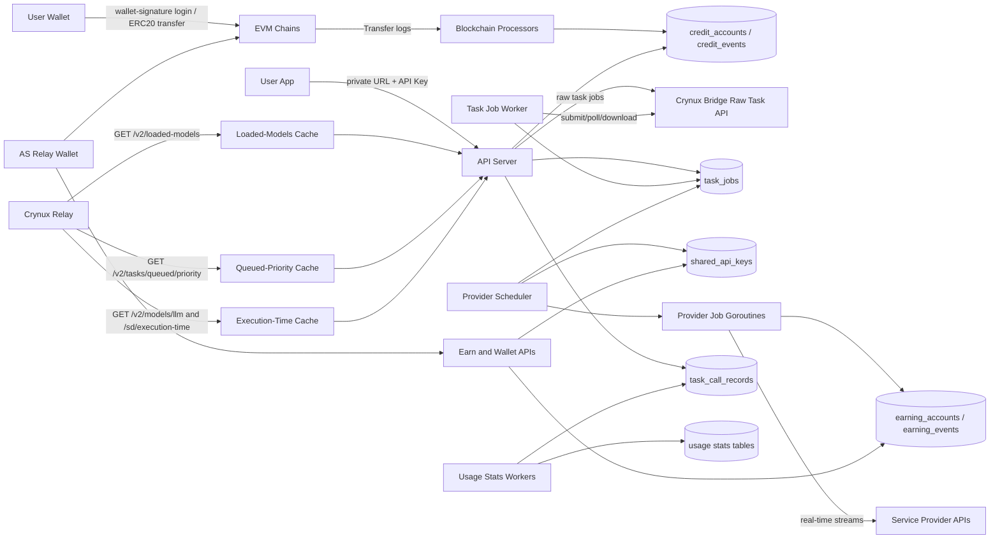

# Technical Architecture

## System Boundary

Crynux AS is one off-chain backend service backed by one MySQL database. It works with multiple configured blockchain networks for receiving ERC20 payments, with one Crynux Bridge instance for Crynux task execution, with one Crynux Relay instance for the loaded Crynux model catalog, and with configured OpenAI, Anthropic, and Google APIs for Provider text-model execution. It stores encrypted user-owned Shared API Keys, records Key Owner CNX earnings, and exposes settlement APIs to one unmodified Relay Wallet deployment. The term `network` in this document means blockchain network.

## Components

* **API server** (`api/`): gin + fizz + tonic HTTP server. Serves the management APIs under `/v1` (auth, account, projects, project API key reset, stats) and the private OpenAI-compatible LLM endpoints under `/api/<endpoint_token>/v1`. The tonic error and render hooks in `api/v1/response` produce the uniform `{"message": ...}` response envelope, and the OpenAPI specification is generated from the route declarations.
* **Blockchain processors** (`service/`): one worker goroutine per configured network that scans ERC20 `Transfer` logs to the receiving address and converts them into deposits and Credits ledger events.
* **Blockchain clients** (`blockchain/`): one eth client per configured network with a per-network RPS rate limiter. All RPC requests of a network MUST pass through its limiter. The package also provides Ethereum personal-sign signature verification used by wallet login.
* **Bridge client** (`bridge/`): submits persisted LLM jobs to the Crynux Bridge raw task APIs using the platform-level Bridge API key from the configuration. AS parses public OpenAI requests into canonical `GPTTaskArgs`, including `response_format`, function tools, and `tool_choice`; queries Bridge ClientTask status; downloads raw `GPTTaskResponse` JSON; parses declared tool formats by generated syntax; and formats chat completions, completions, and responses output locally. Structured JSON content remains ordinary assistant content. The resolved effective VRAM is sent as `min_vram` on raw task creation. See [llm-api.md](./llm-api.md).
* **Task job workers** (`service/`, `tasks/`): one Bridge poller loads bounded batches of unfinished Bridge `task_jobs`, batch-submits LLM and Image jobs, batch-queries status, and downloads results without blocking on one task. One independent Provider scheduler loads queued Provider jobs by priority, reserves process-local Shared API Key concurrency slots, and starts one goroutine per claimed upstream call. After a definitely unaccepted key-specific failure, a Provider goroutine records that Key's unavailable count and switches to a different eligible Key; the same job never selects the failed Key again. Provider goroutines also own real-time stream conversion, final usage, and settlement. Both paths share Credits hold, call-record, and terminal settlement services. A successful Image job MUST download every expected PNG into `{llm.task_result_dir}/{task_jobs.id}/` before settle. Startup MUST fail submitted or in-progress Provider jobs from the prior process without replaying upstream requests. Retention and Credits-lock reconciliation remain bounded background tasks. See [llm-job-processing.md](./llm-job-processing.md) and [provider-key-sharing/job-execution.md](./provider-key-sharing/job-execution.md).
* **Service Provider adapters** (`provider/`): validate uploaded OpenAI, Anthropic, and Google keys, translate the supported public request semantics, execute real upstream streams, normalize final results and usage, classify failures, and redact Provider errors. Adapters MUST NOT select keys or update financial ledgers. Provider models and usage weights come only from YAML configuration. See [provider-key-sharing/provider-adapters.md](./provider-key-sharing/provider-adapters.md).
* **Provider Key and earnings services** (`service/`, `api/v1/`): manage AES-256-GCM-encrypted Shared API Keys, user enable/disable/delete state, key health, Key Owner available and withdrawal-locked CNX balances, and Wallet-compatible withdrawal records. The AS database stores ciphertext, nonces, and SHA-256 fingerprints; one encryption-key file is loaded at startup. See [provider-key-sharing/key-security.md](./provider-key-sharing/key-security.md), [provider-key-sharing/wallet-settlement.md](./provider-key-sharing/wallet-settlement.md), and [provider-key-sharing/wallet-api.md](./provider-key-sharing/wallet-api.md).
* **AS Relay Wallet**: an unmodified `crynux-relay-wallet` instance reads AS event logs and withdrawal requests through the existing Relay protocol, executes CNX transfers, and reports fulfill or reject. It MUST use an independent database, API signer, hot wallet, and funding pool, and only one active instance may run.
* **Relay client** (`relay/`): calls the public Relay APIs without authentication: `GET {relay.base_url}/v2/loaded-models`, `GET {relay.base_url}/v2/tasks/queued/priority`, and `GET {relay.base_url}/v2/models/llm/execution-time`.
* **HuggingFace client** (`service/huggingface/`): validates create-time model ids that are absent from the loaded-models caches by calling Hub `GET {huggingface.api_base_url}/api/models/{model}`. Absolute URLs MUST be rejected before any Hub call. LLM validation MUST require the repo to exist. Image validation MUST require `model_index.json`. Successful and permanent-failure Hub results MAY be cached for `huggingface.cache_ttl_seconds`; Hub unavailable results MUST NOT be cached. Create-time validation MUST run before Credits reservation. See [llm-api.md](./llm-api.md) and [raw-task-api.md](./raw-task-api.md).
* **Loaded-models cache** (`service/`): one in-memory snapshot of the Relay loaded models with `model_type == "llm"`, keyed by `(model_cache_hash, lowercase execution_dtype)`. `model_cache_hash` is the lowercase hex encoding of the 32-byte Relay hash of `model_cache_config`, and `model_cache_config` is the canonical JSON object Relay derives the hash from; `model_cache_hash` MUST be the only cache identity. Each cached row MUST store `model_cache_hash`, the task kind, `model_id`, `min_vram`, `in_memory_node_count`, `on_disk_node_count`, `execution_dtype`, and `quantization_config` from Relay. A row whose `model_cache_hash` is missing or not 32-byte hex, whose `model_cache_config` is missing or unparsable, whose `task_kind` does not match `model_type`, or whose config model, `dtype`, or `quantization_config` differs from the top-level `model_id`, `execution_dtype`, or `quantization_config` MUST be skipped with a warning log. The cache MUST be refreshed once at startup before the HTTP server starts and then every `llm.loaded_models_refresh_interval` seconds by a background task in `tasks/`. A failed startup refresh MUST be logged, MUST leave the cache empty, and MUST NOT prevent startup. A failed periodic refresh MUST retain the last successful snapshot and retry at the next interval. A successful refresh MUST replace the whole snapshot and MUST also replace an in-memory LLM catalog snapshot containing only rows whose `on_disk_node_count` is greater than or equal to `llm.min_catalog_on_disk_node_count`. `GET /models`, `GET /models/<model>`, and pricing-example selection MUST read that catalog snapshot. Default `min_vram` lookup by model id alone MUST select the full-snapshot row with the greatest `min_vram`, with ties broken by canonical `quantization_config` ascending, then `execution_dtype` ascending, then `model_cache_hash` ascending. This lookup MUST be used only for model-level checks and LLM defaults. Create-time Hub validation MUST skip the Hub lookup when any row for the model is present in this full snapshot. The cache is not persisted to the database.
* **Image loaded-models cache** (`service/`): an independent in-memory snapshot of Relay loaded models with `model_type == "sd"`, keyed by `(model_cache_hash, lowercase execution_dtype)` and validated with the same rules as the LLM cache. It MUST refresh from the same Relay response without adding Image models to the LLM cache. Each cached row MUST store `model_cache_hash`, `model_id` (the base model), `min_vram`, `in_memory_node_count`, `on_disk_node_count`, `execution_dtype`, `quantization_config`, the executable `components` (usage name to `{format, repo, format_kwargs}`, converted from the Relay `repository` field to the TaskArgs `repo` field), and `lora` (an object or `null`), all parsed from `model_cache_config`. Rows that differ only by one component repository MUST remain separate rows. A successful refresh MUST also replace an in-memory Image catalog snapshot filtered by the same `llm.min_catalog_on_disk_node_count` threshold. `GET /models/image` MUST read the Image catalog snapshot.

Image TaskArgs execution resolution MUST use one shared resolver for Raw Image create, Images generations, and Images edits. When the request supplies a concrete `dtype` (`float16`, `bfloat16`, or `float32`), AS MUST keep every client execution field unchanged, MUST NOT require a loaded-models hit, and MUST NOT copy fields from any other row. An exact full-identity hit (`model_id`, `execution_dtype`, `quantization_config`, `components`, and `lora`) MAY supply `min_vram`; otherwise AS MUST use the user `min_vram` / `vram_limit` when present, or `llm.default_vram_limit`. When the request omits `dtype` or sets `dtype` to `auto`, AS MUST select one coherent Image loaded-models row whose identity agrees with every client-supplied `quantization_config`, `components`, and `lora` constraint; a request without `lora` MUST consider only rows with `lora` equal to `null`. AS MUST select the greatest `min_vram` among matching rows, with ties broken by canonical `quantization_config` ascending, then `execution_dtype` ascending, then `model_cache_hash` ascending. AS MUST write that row's concrete `execution_dtype` into TaskArgs `dtype`, and MUST write omitted `quantization_config` and `components` from that same row. AS MUST NOT combine fields from different rows. When auto mode finds no matching row, or the matched row's `execution_dtype` is empty, `auto`, or otherwise not concrete, AS MUST reject the request with an invalid-request error before Credits reservation. Images generations and Images edits MUST NOT accept client `dtype`, so they always use the auto resolution path.
* **Queued-priority cache** (`service/`): one in-memory snapshot of the Relay queued-task priority range from `GET /v2/tasks/queued/priority`. The cache MUST be refreshed once at startup before the HTTP server starts and then every `llm.queued_priority_refresh_interval` seconds by a background task in `tasks/`. A failed startup refresh MUST be logged and MUST NOT prevent startup. A failed periodic refresh MUST retain the last successful snapshot and retry at the next interval. A successful refresh MUST replace the snapshot. When a successful refresh returns an empty queue, the cache MUST retain the most recent non-empty `median_priority_gwei` for management UI cost-level hints. The live median MUST NOT enter Credits or task fee. The cache is not persisted to the database.
* **Execution-time cache** (`service/`): independent in-memory TTL entries for LLM and Image execution-time coefficients keyed by model, dtype, canonical `quantization_config`, and the selected minimum-VRAM or exact-GPU hardware tuple. Entries MUST be fetched on demand from Relay `GET /v2/models/llm/execution-time` or `GET /v2/models/sd/execution-time` using the `quantization_config` query parameter. The TTL MUST be `llm.execution_time_cache_ttl` seconds. The cache MUST NOT run a full-catalog refresh timer. The cache is not persisted to the database.
* **Usage stats workers** (`service/`, `tasks/`): one base aggregation worker that advances a call-record cursor into account/project hourly and project 10-minute stats tables and updates each project's `last_request_at`, and one snapshot worker that rebuilds model Top-10 and completion-duration histogram snapshots from the 10-minute tables, refreshes each claimed project's current-Unix-day summary fields on `projects` from `project_usage_hourly_stats`, refreshes each claimed project's recent-failure-window success and failure counts on `projects` from `project_model_usage_10m_stats` using `usage_stats.recent_failure_window_seconds`, refreshes a bounded batch of projects whose recent-window counts still need sliding-window aging, and clears stale day summary fields after the Unix day boundary.
* **MySQL database**: all persistent state. Schema changes are applied by versioned gormigrate migrations in `migrate/` at startup.

## Startup Order

`main.go` initializes components in this order: configuration and Provider encryption secrets, logging, database, migrations, blockchain clients, existing external clients, Service Provider adapters, encryption-secret file removal, prior-process Provider job failure and Credits-hold recovery, existing blockchain and usage workers, initial loaded-models and queued-priority refreshes, Bridge poller, Provider scheduler, the existing Credits-lock reconciler, and finally the HTTP server. The complete Provider startup contract is specified in [provider-key-sharing/architecture.md](./provider-key-sharing/architecture.md).

## Multi-Chain Multi-Token Configuration Model

The complete configuration template is [config/config.example.yml](../config/config.example.yml). The configuration defines a map of blockchain networks, and each network defines a map of supported ERC20 tokens under `blockchains.<network-name>.tokens`.

Configuration loading MUST fail with an error when a required item is missing. `credits.signup_bonus` MUST be present and MUST be a non-negative integer; `0` disables the signup bonus. `credits.referral.deposit_reward_ratio`, `credits.referral.invitee_bonus`, and `credits.referral.purchase_bonus_tiers` MUST be present. `deposit_reward_ratio` MUST parse as a non-negative decimal less than or equal to `1`. `invitee_bonus` MUST be a non-negative integer; `0` disables the invitee signup bonus. `purchase_bonus_tiers` MUST be a list and MAY be empty; each tier MUST define positive unique `min_purchases` and a non-negative `extra_ratio` less than or equal to `1`, and `deposit_reward_ratio` plus all tier `extra_ratio` values MUST be less than or equal to `1`. Each network gets exactly one blockchain client, one scanning worker, and one `blockchain_cursors` row keyed by the network name. The worker polls on `scan_interval` seconds. The worker MUST scan only blocks at or below `latest - confirmation_blocks`; `confirmation_blocks` of `0` means scan up to the latest block. Credits for a deposit are computed as `amount * credits_per_token / 10^decimals` using integer arithmetic. `relay.base_url` is the public Relay URL for loaded-models, queued-priority, and execution-time fetches. `huggingface.api_base_url`, `huggingface.timeout_seconds`, and `huggingface.cache_ttl_seconds` configure create-time Hub model validation. `task_schema.stable_diffusion_inference`, `task_schema.gpt_inference`, and `task_schema.stable_diffusion_finetune_lora` MUST be present schema URLs used to validate Raw TaskArgs before Credits reservation. The shared LLM configuration items, including `llm.task_result_dir` for Image PNG storage, are specified in [llm-api.md](./llm-api.md). Credits billing and the shared `billable_gwei` / project `priority_gwei` task fee inputs are specified in [credits-billing.md](./credits-billing.md). Job retention, Image result directories, and table ownership are specified in [llm-job-processing.md](./llm-job-processing.md). `usage_stats.recent_failure_window_seconds` and `usage_stats.recent_failure_rate_threshold` configure the project recent-failure-window counts and `elevated_recent_failure_rate` flag returned by project list and detail APIs.

## Data Model

| Table | Content |
|-------|---------|
| `users` | Wallet address as the unique user identity |
| `credit_accounts` | One row per user; the current Credits `balance` and soft-lock `locked`; available Credits are `balance - locked` |
| `credit_events` | Append-only Credits ledger; every balance change is one event referencing its source record by `ref_id`; unique by type + `ref_id`; LLM charge amounts are the sole permanent store of charged Credits |
| `deposits` | Detected ERC20 transfers; unique by network + tx hash + log index |
| `referral_codes` | Per-user invite codes; `code` unique; status active or revoked; at most one active code per user in normal operation |
| `referral_bindings` | Permanent invitee-to-referrer bind created at first login; unique by `invitee_user_id` |
| `referral_rewards` | Referrer reward source rows for deposit rewards; unique by `deposit_id`. Each deposit reward stores `prior_purchase_count`, highest applied `tier_min_purchases`, summed `extra_ratio`, and `extra_amount` Credits from tiers. Historical one-time milestone bonus rows may exist with unique `milestone_referrer_user_id`; new milestone bonus rows MUST NOT be created |
| `blockchain_cursors` | Per-network scan cursor; unique by network |
| `projects` | User projects; unique `endpoint_token` forms the private base URL; stores the project API key hash, public prefix, Cost Level mode (`static` or `auto`), static `priority_gwei`, auto `auto_queue_position` and `auto_max_priority_gwei`, `last_request_at`, current-Unix-day usage summary fields (`request_count_day`, `success_count_day`, `failure_count_day`, `credits_day`), and recent-failure-window counts (`recent_window_success_count`, `recent_window_failure_count`) |
| `task_jobs` | Temporary execution rows for OpenAI-compatible and Raw LLM or Image tasks; stores ownership, execution source, task/API type, source-specific canonical request data, nullable Bridge ID, status, result metadata, versioned create-time billing data, sortable priority, queue timeout, and Credits hold fields; retained for `llm.job_retention_days` after terminal settle. Provider queue expiration is calculated from `created_at + queue_timeout`; no separate Provider queue-deadline column is stored. Image PNG results live under `llm.task_result_dir` and MUST NOT be stored in this table |
| `task_call_records` | Permanent finished-call rows with task/job ownership, execution source, exact display model, nullable Relay identity, nullable Provider `shared_api_key_id`, applicable usage, status, times, duration, Cost Level, and source-specific billing display fields; MUST NOT store request bodies, result bodies, complete pricing coefficients, or charged Credits amounts. Provider Key identity MUST remain internal and MUST NOT be exposed to API Consumers |
| `shared_api_keys` | User-owned Shared API Keys with owner state, soft-delete state, cooldown state, fingerprint, AES-256-GCM ciphertext, and nonce. Active slot counts exist only in process memory |
| `earning_accounts` / `earning_events` | Key Owner available and withdrawal-locked CNX balances and the permanent Wallet-compatible earnings ledger |
| `earning_withdrawals` | User-authorized CNX withdrawal requests, event anchors, Wallet callback state, and transaction hashes |
| `account_usage_hourly_stats` | Per-account Unix-hour aggregates of requests, success, failure, tokens, Image `image_count`, and charged Credits |
| `project_usage_hourly_stats` | Per-project Unix-hour aggregates with the same metrics plus `user_id` |
| `project_model_usage_10m_stats` | Per-project Unix 10-minute aggregates. Crynux rows use `(project_id, execution_source, model_cache_hash, execution_dtype, period_start)` with `execution_source = crynux`; Provider rows use `(project_id, execution_source, exact_model, period_start)`, where `execution_source` is `openai`, `anthropic`, or `google`, without a fabricated Relay identity. Rows store display model, task type, applicable configuration, token totals, and image count |
| `project_duration_usage_10m_stats` | Per-project Unix 10-minute completion-duration small-bucket counts |
| `project_model_usage_snapshots` | Per-project Top-10 model snapshots for `1h`, `1d`, and `7d`, keyed by the same execution-source identity as the 10-minute table |
| `project_duration_histogram_snapshots` | Per-project displayable completion-duration histogram snapshots for `1h`, `1d`, and `7d` |
| `usage_stats_progress` | Base aggregation cursor (`project_id = 0`) and per-project snapshot dirty/claim generations |

## Deposit Flow

1. The user transfers a supported ERC20 token from the login wallet to the receiving address of a configured network.
2. The network's blockchain processor ticks on `scan_interval`, reads the scan cursor, computes `confirmed_tip = latest - confirmation_blocks`, and fetches `Transfer` logs of all configured token contracts filtered by `to == receiving_address` in ranges of at most `log_block_range` blocks up to `confirmed_tip`, with each RPC request passing the network RPS limiter.
3. The token amount is converted to Credits with `credits_per_token`. When the computed Credits is less than `1`, the processor emits a warning log and ignores the transfer. No `deposits` or `credit_events` row is created.
4. When no user account exists for the transfer `from` address, the processor emits a warning log and ignores the transfer. No `deposits` or `credit_events` row is created.
5. When the user exists and the computed Credits is at least `1`, the log becomes a `deposits` row identified by network + tx hash + log index. The unique index makes re-processing idempotent. A `credit_events` row of type deposit referencing the deposit ID is created, and the `credit_accounts` balance is updated in the same database transaction after locking the account row with `SELECT ... FOR UPDATE`.
6. When the depositing user has a referral binding, the same transaction MUST compute `prior_count` as the number of deposits by that referrer's invitees excluding the current deposit, set `extra_ratio` to the sum of matching `purchase_bonus_tiers` `extra_ratio` values where `prior_count >= min_purchases`, set `effective_ratio` to `deposit_reward_ratio + extra_ratio`, and grant `reward = floor(deposit_credits * effective_ratio)` Credits to the referrer when that amount is greater than zero, by inserting a `referral_rewards` deposit-reward row that also stores `prior_purchase_count`, the highest matching `tier_min_purchases`, `extra_ratio`, and `extra_amount = reward - floor(deposit_credits * deposit_reward_ratio)`, a referral-reward ledger event, and updating the referrer's locked account balance.
7. The cursor advances only after all logs in the range are handled (credited or ignored).

## Task Charging Flow

The authoritative Crynux Credits charging rules are specified in [credits-billing.md](./credits-billing.md). Crynux task fee estimation is specified in [llm-api.md](./llm-api.md). The Crynux Bridge high-level flow is:

1. The client sends an OpenAI-compatible request to `/api/<endpoint_token>/v1/...` with a project API key in the `Authorization` header.
2. The API server locates the project by `endpoint_token`, validates the API key hash against the project's stored key hash, and resolves the effective VRAM from the user `vram_limit`, the loaded-models cache, and the configured default.
3. The API server resolves the request effective `priority_gwei` from the project Cost Level mode (static stored value, or auto linear position within the current queue bounds capped by `auto_max_priority_gwei`), fetches and validates LLM execution-time coefficients, computes one shared `billable_gwei` from that effective priority, sets `task_fee_gwei = floor(billable_gwei)`, clamps both amounts to `llm.max_task_price_cnx` when the uncapped fee would exceed that CNX ceiling, resolves a Queue Median Hint snapshot, and in one transaction reserves `estimate` Credits against `available = balance - locked` then creates the job with a `held` Credits lock. Coefficient fetch or validation failure MUST return HTTP 500, MUST record a failed call without fee fields, and MUST NOT create an LLM job for forwarding. Insufficient available Credits MUST return HTTP 402. The live median MUST NOT enter `billable_gwei`. For static mode, live queue bounds MUST NOT enter `billable_gwei`. For auto mode, live queue bounds MAY determine the effective `priority_gwei` at job create; after that snapshot, later queue changes MUST NOT alter the job charge. The `priority_gwei` snapshot MUST remain the uncapped effective Cost Level.
4. The API server returns immediately for responses with `background=true`, or waits synchronously for chat completions, completions, and responses with `background=false`.
5. The LLM job worker converts the persisted GWei fee to Wei and submits unfinished jobs through Bridge raw task batch create. Each successful create persists the returned Bridge client task ID. On later ticks the worker batch-queries ClientTask status, downloads the raw `GPTTaskResponse` for each successful job, formats the public API result, settles Credits, and only then marks the job `completed`.
6. The charge is calculated from the raw result `usage` token counts, the job `priority_gwei` snapshot, the persisted execution-time coefficients, `vram_weight`, and `credits_per_gwei`, then clamped by the same `llm.max_task_price_cnx` ceiling used at create. Successful settle MUST release the Credits hold, then debit `min(computed_credits, balance)`. One `task_call_records` row records the call with tokens, the `priority_gwei` used for the charge, billed effective VRAM, pre-submit task-fee fields, and the Credits recalculation snapshot. The actual Credits debit MUST be stored only on a processed task-charge `credit_events` row when `charge > 0`. Successful settle and failed terminal recording MUST each commit the job row lock, hold release, call record, ledger changes when charged, and job terminal update in one database transaction. The complete ownership and transaction rules are specified in [llm-job-processing.md](./llm-job-processing.md).
7. The usage stats base worker aggregates finished call records into hourly and 10-minute stats tables using processed LLM charge ledger amounts and updates `projects.last_request_at`. The snapshot worker refreshes model Top-10 and completion-duration histogram snapshots from the 10-minute tables, writes current-Unix-day summary fields onto `projects` from `project_usage_hourly_stats`, writes recent-failure-window success and failure counts onto `projects` from `project_model_usage_10m_stats`, refreshes a bounded aging batch for those recent-window counts, and clears stale day summary fields after the Unix day boundary.

Provider jobs share project authentication, Credits reservation, call records, usage statistics, and terminal transaction ownership, but use configured usage weights instead of Relay execution-time and VRAM inputs. The Provider scheduler assigns Shared API Key slots by Cost Level priority, Provider goroutines stream output in real time, and final usage creates both the consumer charge and immediately available Key Owner CNX earning. See [provider-key-sharing/pricing-billing.md](./provider-key-sharing/pricing-billing.md).

## Credits Ledger Consistency Rules

* Every Credits balance change MUST be recorded as a `credit_events` row; the `credit_accounts` balance MUST equal the sum of its processed events.
* Soft locks change only `credit_accounts.locked` and MUST NOT write `credit_events`. `locked` MUST remain non-negative. Available Credits are `balance - locked`.
* Ledger event creation and the corresponding balance update MUST be committed atomically in one database transaction.
* Every transaction that updates `credit_accounts.balance` or `credit_accounts.locked` MUST lock that account row with `SELECT ... FOR UPDATE` before reading and writing those fields.
* Job create MUST reserve Credits and insert the job in one transaction. Success settle and failure recording MUST release a `held` lock in the same transaction as the terminal job update.
* Every ledger event references its source record by `ref_id`: the `deposits` row ID for deposit events, the `task_call_records` row ID for task-charge events, the `users` row ID for signup-bonus and invitee-bonus events, and the `referral_rewards` row ID for referral-reward events. The event type + `ref_id` pair is unique; retrying an operation MUST NOT produce a duplicate event.
* Deposit crediting and LLM charging may be delayed, but processed data MUST remain correct and consistent across unexpected exceptions and shutdown.
* A startup and periodic reconciler MUST correct `credit_accounts.locked` to the sum of held job `credits_locked` values when they diverge, and MUST emit an error log.
