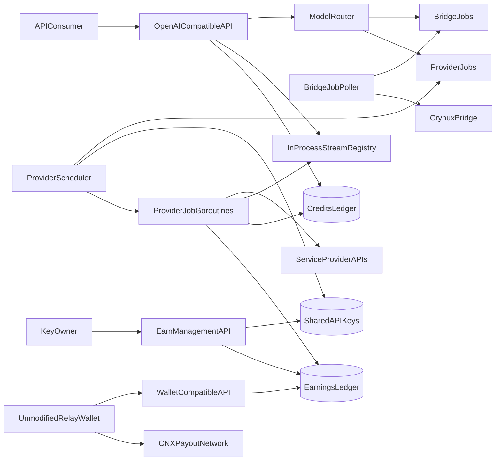

# Provider Key Sharing Architecture

## System Boundary

Provider Key Sharing extends the existing single-process Crynux AS service and its MySQL database. It adds Service Provider adapters, a Provider scheduler, encrypted Shared API Keys, a Key Owner earnings ledger, and Relay Wallet-compatible settlement APIs.

Crynux Bridge remains the only executor for Crynux models. OpenAI, Anthropic, and Google remain external synchronous or streaming HTTP services. The unmodified Relay Wallet remains the component that signs, broadcasts, confirms, and reports CNX withdrawal transactions.

## Components



## Configuration Catalog

The YAML configuration MUST define:

* one global per-key concurrency limit;
* Provider scheduler and stream-buffer limits;
* one Provider Key encryption-key file;
* each enabled Service Provider;
* each Service Provider base URL and timeout;
* each official model name;
* each model's usage weights;
* withdrawal networks, fees, Beneficial Address contracts, and Wallet signer.

Configuration loading MUST construct an immutable in-memory map keyed by exact Provider model name. Provider model declarations MUST NOT be stored in the database. A configuration change takes effect only after a successful AS restart.

## Model Routing

Request routing MUST occur before Credits reservation.

1. Trim surrounding whitespace from the public `model` value.
2. Look for an exact, case-sensitive match in the configured Provider model map.
3. When found, set `execution_source` to the configured Service Provider value (`openai`, `anthropic`, or `google`) and select its usage weights.
4. When not found, run the existing Hugging Face model normalization, validation, loaded-model resolution, and Bridge routing.
5. Route Chat Completions and Responses requests through the selected Service Provider adapter, which owns translation to its native API.

The selected execution source and complete billing configuration MUST be persisted on the job. A worker MUST NOT re-route an accepted job using current configuration.

## Shared Admission Layer

Bridge and Provider requests MUST share one admission layer for:

* project authentication;
* model routing;
* public request validation;
* effective Cost Level resolution;
* charge estimation;
* account row locking;
* Credits reservation;
* durable job creation;
* synchronous wait, background response, and retained Responses lookup.

The admission transaction MUST insert the job and increase `credit_accounts.locked` atomically.

Bridge-specific execution coefficients and Provider-specific usage weights MUST remain separate versioned billing-data variants under the shared job model.

## Execution Layer

The top-level job task MUST start two independent workers:

```text
RunJobWorkers
  RunBridgeJobPoller
  RunProviderScheduler
    RunProviderJob goroutines
```

`RunBridgeJobPoller` is the existing Bridge job loop moved under `RunJobWorkers`. Its behavior MUST remain unchanged except that it loads only `execution_source = crynux` jobs.

The Provider scheduler MUST select queued Provider jobs by priority, reserve an eligible Shared API Key slot in process memory, claim the job, and launch one goroutine per claimed job. The scheduler MUST never wait for an upstream request to complete.

Provider job goroutines MUST own upstream connection lifetime, switching to another Key after a definitely unaccepted key-specific failure, real-time stream conversion, final usage normalization, result assembly, settlement, and slot release.

A failure in one worker MUST NOT stop the other worker.

## Stream Delivery

AS is a single process. Real Provider streams MUST use an in-process registry keyed by task job ID.

* The HTTP handler MUST register a bounded subscriber before waiting for execution.
* The Provider job goroutine MUST publish normalized OpenAI-compatible stream events.
* Publication MUST NOT block upstream reading.
* A full subscriber buffer MUST detach the slow subscriber and terminate its downstream response.
* Client disconnect MUST detach the subscriber without cancelling upstream execution.
* The Provider job goroutine MUST continue until final usage and settlement.
* Credits charge, token usage recording, and Key Owner earning MUST follow only whether the Service Provider completed the request. Settlement MUST complete when the Service Provider completes the request.
* Stream chunks MUST NOT be written to permanent tables.
* The goroutine MUST assemble the final normalized result required for job completion, Responses lookup, and `previous_response_id`. Confirmed final usage MUST be accompanied by that result.

Crynux Bridge jobs MUST retain their current completion-first simulated SSE behavior.

## Persistent Boundaries

`task_jobs` remains temporary execution state. It MUST contain:

* execution source;
* selected Service Provider when applicable;
* model and API type;
* immutable billing snapshot;
* Credits hold;
* temporary raw and formatted result data;
* terminal call-record reference.

`task_call_records` remains the permanent consumer-facing usage record. Provider rows MUST also store the final `shared_api_key_id` for Key Owner history queries, but that field MUST NOT be exposed to API Consumers.

`credit_events` remains the only permanent source of API Consumer Credits changes.

`earning_events` remains the only permanent source of Key Owner CNX balance changes.

## Failure Isolation

* An invalid request MUST fail before job creation.
* A queue timeout MUST fail without an upstream request.
* After a definitely unaccepted key-specific failure, the Provider goroutine MUST atomically record the failed Key's unavailable count, exclude that Key for the rest of the job, and MAY select another eligible Key while `task_jobs.created_at + task_jobs.queue_timeout` has not expired and the configured try limit permits. The failed Key may be selected by a later job unless it entered cooldown. Intermediate tried-Key state and switches MUST remain in memory.
* An uncertain upstream request MUST NOT be retried automatically.
* A downstream disconnect MUST NOT change job state or settlement.
* When the Service Provider completes the request, settlement MUST complete as a completed job with a success call record. API Consumer disconnect and public-delivery outcome MUST NOT cancel that settlement.
* A successful upstream response without verifiable final usage MUST fail settlement and enter operator investigation.
* A process restart MUST close every active downstream stream. Submitted or in-progress Provider jobs from the prior process MUST fail without consumer charge and MUST NOT be resubmitted.

## Startup Order

AS MUST initialize Provider Key Sharing in this order:

1. load and validate ordinary configuration;
2. read and validate every configured encryption secret file;
3. initialize logging;
4. initialize MySQL;
5. run migrations;
6. initialize blockchain clients and existing external clients;
7. initialize Service Provider adapters;
8. validate and remove the encryption-key file;
9. fail submitted or in-progress Provider jobs from the prior process and recover Credits holds and earnings balances;
10. start existing blockchain and usage workers;
11. refresh existing Crynux model and queue caches;
12. start Bridge poller, Provider scheduler, and reconciliation workers;
13. start the HTTP server.

AS MUST NOT accept a Provider call before recovery and initial catalog construction finish.
